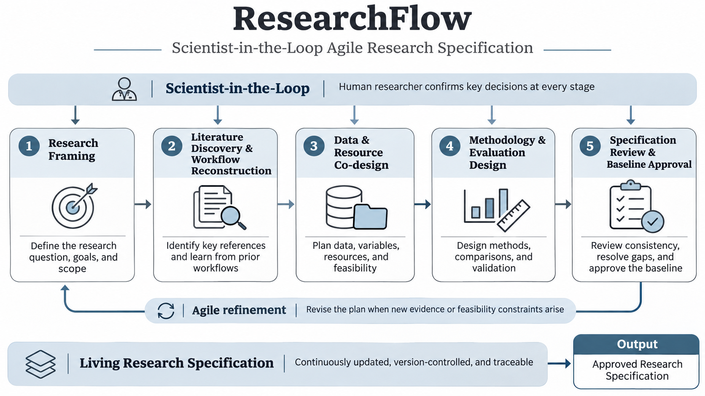

# ResearchFlow

**Scientist-in-the-Loop Agile Research Specification**

[한국어 안내](README.ko.md) · [Install](docs/installation.md) ·
[Architecture](docs/architecture.md) · [Review status](docs/review-report.md)

ResearchFlow is a reusable AI-agent skill for **co-designing and maintaining a research
specification with a human researcher before execution**. It works across quantitative,
experimental, computational, qualitative, theoretical and mixed-method research.

The researcher participates in each stage. The specification is a living document:
new evidence, unavailable data, or changed constraints trigger an impact review,
scoped confirmation, and a versioned amendment. Reverse engineering of reference
papers is an important Stage 2 function, not the framework's central organizing idea.



## The fixed five stages

| # | Stage | What is co-designed |
|---|---|---|
| 1 | Research Framing | Question, purpose, research mode, contribution, scope and constraints |
| 2 | Literature Discovery & Workflow Reconstruction | Reference selection, reported research workflows, comparisons and transfer decisions |
| 3 | Data & Resource Co-design | Data/material/resource definitions, acquisition, feasibility and alternatives |
| 4 | Methodology & Evaluation Design | Procedures, dependencies, comparison, validation and interpretation |
| 5 | Specification Review & Baseline Approval | Integrated review, explicit conditions, researcher approval and a versioned baseline |

Every stage follows **proposal → evidence and alternatives → discussion → confirmation
→ specification update**. Stages remain fixed; their research content is revisable.

## What it does—and does not do

ResearchFlow drafts and reviews planning documents, searches and inspects literature,
reconstructs reported methods, reviews metadata, and designs acquisition and evaluation
plans. It does **not** collect or process actual research data, run analyses, train
models, conduct experiments/simulations, generate production analysis code, or invent
results. Reading a paper's code does not authorize executing it.

**Approval ≠ evidence verification ≠ resource availability.** An approved plan can be
conditional on future data collection. A checklist pass is not scientific validation,
ethical approval, preregistration, or permission to execute a study.

## Install locally

Requires a host that supports Agent Skills. The canonical, portable skill is
[`skills/researchflow`](skills/researchflow). Optional local tools use Python 3.10+
with no third-party Python dependencies.

From a downloaded or cloned source directory:

```bash
# Claude Code: creates ~/.claude/skills/researchflow (never overwrites an installation)
python tools/install_skill.py --target claude

# Codex: creates ~/.agents/skills/researchflow
python tools/install_skill.py --target codex
```

Use `/researchflow` in Claude Code or `$researchflow` in Codex. Natural-language
selection is host-dependent, so explicit invocation is best for initial checks.
For custom-skill upload interfaces, use the **skill-only ZIP**, which contains
`researchflow/SKILL.md` at the required top-level folder. Read the
[installation guide](docs/installation.md); account policies and supported surfaces vary.
Installing a skill is not the same as connecting a literature database or granting
repository write access.

## Start a research conversation

> Use ResearchFlow to help me design this research: [question]. Start from my current
> context, discuss the important decisions with me, and obtain confirmation at each
> stage. Do not run the research. Keep the specification up to date as constraints change.

For an amendment:

> The planned dataset cannot be obtained. Review the impact on the current specification,
> compare alternatives, and ask me to confirm a revised design. Preserve the old baseline.

The skill responds in the researcher's language. Its five file-section headings stay
consistent so optional bookkeeping tools can recognize them.

## Resulting research workspace

```text
my-research/                   # Private project workspace, not this distribution
├── research_spec.md           # Living draft with five sections
├── project_state.json         # Structured state and scoped approvals
├── decision_log.md
├── search_log.md
├── references/                # Workflow cards and evidence locators
├── changes/                   # Amendment proposals and decisions
└── versions/                  # Preserved approved snapshots
```

The core can work in a chat without Python or persistent files, but then it must say
that its state has not been saved. The optional [helper](skills/researchflow/references/helper-usage.md)
checks content-bound receipts and snapshots. It cannot authenticate human identity,
interpret an approval quote, or prove scientific soundness.

## Validation and packaging

```bash
python -m unittest discover -s tests -v
python tools/validate_package.py
python tools/build_release.py
```

The build produces a skill-only ZIP, a source ZIP and SHA-256 checksums in `dist/`.
No credentials, private research projects or uploaded manuscripts are bundled.
[Evaluation scenarios](evals/evals.json) are provided for future real-model testing;
unit tests and desk review are **not** model-behavior or research-quality benchmarks.

## Development and release status

Initial package version: **0.1.0**. See [CHANGELOG](CHANGELOG.md) and the
[review report](docs/review-report.md) for what was actually checked. Host installation
smoke tests, behavioral evaluations and remote publication are reported separately.

The repository is prepared for `YeongChanLee/ResearchFlow`; preparation does not
itself establish that it has been published. An authenticated maintainer can use the
[publication guide](docs/publishing.md) and its explicit-execution helper.

## Provenance and reuse

Concept and research workflow: Yeong Chan Lee. Scientist-in-the-loop collaboration
builds on the design motivation discussed in Epiflow; ResearchFlow generalizes the
planning scope beyond observational studies. The implementation and templates here
are new; no third-party framework code or unpublished manuscript is vendored.
[Sources and design influences](docs/provenance.md) distinguish official packaging
standards from this project's own design choices.

MIT license. Contributions should preserve the five stages, explicit researcher
confirmation, evidence integrity, and the planning-only boundary. See
[CONTRIBUTING](CONTRIBUTING.md) and [SECURITY](SECURITY.md).
